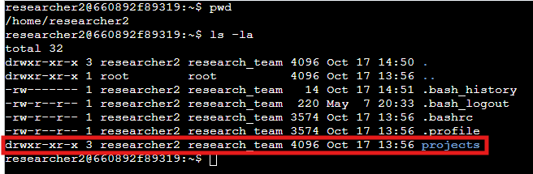
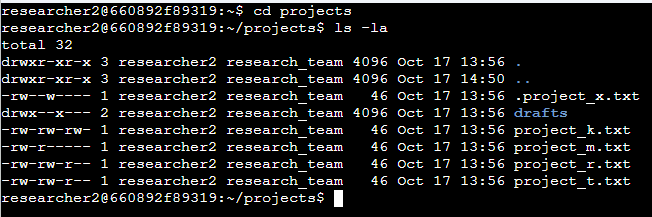
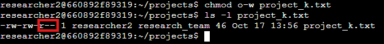
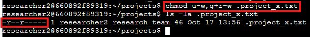
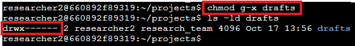

# Gerenciamento de Permissões de Arquivos e Diretórios no Linux

## 1. Descrição do Projeto (Cenário)

Esse laboratório é uma atividade do Google Cybersecurity Certificate. O cenário é que, como parte da equipe de segurança e administração de sistemas de uma organização de pesquisa, minha responsabilidade foi auditar e reestruturar os níveis de autorização de arquivos e subdiretórios no diretório `projects` do usuário `researcher2`. 

O objetivo principal foi garantir o **princípio do menor privilégio**, eliminando permissões de gravação públicas desnecessárias, protegendo arquivos de pesquisa arquivados e restringindo o acesso a rascunhos confidenciais. Por meio de comandos nativos do Bash no Linux (`ls`, `chmod`), analisei a cadeia de permissões (UGO - *User, Group, Others*) e corrigi as permissões com base nas políticas de segurança estabelecidas pela organização.

---

## 2. Verificar Detalhes de Arquivos e Diretórios

Para iniciar a auditoria, foi necessário verificar a localização atual e inspecionar o diretório home do usuário `researcher2` para identificar a pasta de trabalho `projects`:

```bash
# Verificando o diretório de trabalho atual
pwd

# Listando os arquivos e diretórios na home, incluindo itens ocultos
ls -la
```



* **Explicação dos comandos:**
  * `pwd`: Exibe o caminho absoluto do diretório atual (*print working directory*), confirmando que estávamos em `/home/researcher2`.
  * `ls -la`: Lista todos os itens do diretório no formato longo, evidenciando o diretório `projects` pertencente ao usuário `researcher2` e ao grupo `research_team` com permissões `drwxr-xr-x`.

Em seguida, navegamos para o diretório `projects` para auditar todos os arquivos e subdiretórios sob custódia da equipe:

```bash
# Acessando o diretório de projetos
cd projects

# Listando todos os arquivos, metadados e permissões detalhadas
ls -la
```



* **Explicação das opções do comando `ls`:**
  * `-l`: Formato longo (*long format*), exibindo a string de permissões, número de hard links, proprietário, grupo, tamanho em bytes e data/hora da última alteração.
  * `-a`: Lista todos (*all*) os arquivos, incluindo arquivos ocultos (iniciados com `.`), fundamentais para auditorias de segurança pois arquivos confidenciais ou de configuração podem estar ocultos.

### Saída e Permissões Identificadas (Estado Inicial)

A listagem gerada no terminal exibiu a seguinte estrutura inicial de arquivos e permissões:

| Tipo / Nome | Permissões (10 caracteres) | Proprietário | Grupo | Observação |
| :--- | :--- | :--- | :--- | :--- |
| `drafts/` | `drwx--x---` | researcher2 | research_team | Diretório de rascunhos (grupo possui permissão de execução) |
| `project_k.txt` | `-rw-rw-rw-` | researcher2 | research_team | Arquivo de projeto ativo (permissão de gravação pública indevida) |
| `project_m.txt` | `-rw-r-----` | researcher2 | research_team | Arquivo de projeto ativo (leitura restrita a dono e grupo) |
| `project_r.txt` | `-rw-rw-r--` | researcher2 | research_team | Arquivo de projeto ativo (leitura pública, gravação para grupo) |
| `project_t.txt` | `-rw-rw-r--` | researcher2 | research_team | Arquivo de projeto ativo (leitura pública, gravação para grupo) |
| `.project_x.txt`| `-rw--w----` | researcher2 | research_team | Arquivo oculto/arquivado (grupo com permissão anômala de escrita e sem leitura) |

---

## 3. Descrever a Cadeia de Permissões

No Linux, a string de 10 caracteres no início da saída do comando `ls -l` define o tipo de arquivo e as permissões de acesso atribuídas aos diferentes níveis de usuários.

Tomando como exemplo a saída inicial do arquivo `project_k.txt` (`-rw-rw-rw-`):

```text
 -   r w -   r w -   r w -
[1] [ 2 3 4 ] [ 5 6 7 ] [ 8 9 10]
 |      |         |         |
 |      |         |         +---> Others (outros usuários): r (read), w (write), - (sem execução)
 |      |         +-------------> Group (grupo proprietário research_team): r (read), w (write), - (sem execução)
 |      +-----------------------> User/Owner (usuário proprietário researcher2): r (read), w (write), - (sem execução)
 +------------------------------> Tipo de entrada: '-' indica arquivo comum ('d' indicaria diretório)
```

### Detalhamento dos Componentes:
1. **Posição 1 (Tipo de Entrada):**
   * `-`: Arquivo comum (*regular file*).
   * `d`: Diretório (*directory*).
2. **Posições 2–4 (Usuário / Owner - `u`):**
   * Define o que o usuário proprietário (`researcher2`) pode fazer. `rw-` concede leitura (`r`) e gravação (`w`), sem permissão de execução (`-`).
3. **Posições 5–7 (Grupo / Group - `g`):**
   * Define o que os membros do grupo (`research_team`) podem fazer. `rw-` concede leitura e gravação.
4. **Posições 8–10 (Outros / Others - `o`):**
   * Define o que qualquer outro usuário no sistema pode fazer. No caso de `project_k.txt`, `rw-` concedia leitura e gravação pública irrestrita — uma grave vulnerabilidade contra a política de integridade da organização.

---

## 4. Alterar Permissões de Arquivo

A política de segurança da organização determina expressamente que **nenhum outro usuário (`others`) deve ter permissão de gravação (`w`) em arquivos**.

Na auditoria anterior, o arquivo `project_k.txt` apresentava permissão `-rw-rw-rw-`, permitindo que qualquer usuário do sistema alterasse ou sobrescrevesse seu conteúdo. Para revogar a permissão de gravação do grupo `others`, utilizamos o comando `chmod`:

```bash
# Removendo a permissão de gravação (w) de outros usuários (o)
chmod o-w project_k.txt

# Verificando a atualização das permissões do arquivo
ls -l project_k.txt
```



* **Explicação do comando:**
  * `chmod`: Utilitário para alteração do modo de acesso de arquivos (*change mode*).
  * `o-w`: Remove (`-`) o privilégio de escrita/gravação (`w`) da categoria de outros usuários (`o`).
  * `project_k.txt`: O arquivo alvo da modificação.

* **Resultado obtido:** `-rw-rw-r--` (a permissão de leitura foi mantida para terceiros, mas a gravação foi completamente revogada).

---

## 5. Alterar Permissões de Arquivo em um Arquivo Oculto

No Linux, qualquer arquivo ou diretório cujo nome se inicia com um ponto (`.`) é tratado como oculto por convenção, não sendo exibido em listagens convencionais sem a opção `-a`. A equipe de pesquisa arquivou o arquivo `.project_x.txt`.

De acordo com as diretrizes de segurança para arquivos arquivados:
* **Nenhum usuário** deve ter permissão de gravação (`w`) (garantindo a imutabilidade do registro arquivado).
* Apenas o **usuário proprietário (`u`)** e o **grupo (`g`)** devem ter permissão de leitura (`r`).
* **Outros usuários (`o`)** não devem ter permissão alguma (`---`).

Na verificação inicial, o arquivo `.project_x.txt` possuía as permissões `-rw--w----` (o proprietário tinha leitura e gravação, enquanto o grupo possuía apenas gravação indevida sem leitura). Para adequá-lo ao padrão exigido (`-r--r-----`), executamos:

```bash
# Removendo a gravação do dono (u-w), adicionando leitura e removendo gravação do grupo (g+r-w)
chmod u-w,g+r-w .project_x.txt

# Verificando as permissões atualizadas do arquivo oculto
ls -la .project_x.txt
```



* **Explicação do comando:**
  * `u-w`: Remove a gravação do usuário proprietário (`researcher2`), deixando-o apenas com leitura (`r--`).
  * `g+r-w`: Concede leitura (`+r`) e retira gravação (`-w`) do grupo (`research_team`), ajustando-o para (`r--`).
  * O grupo `others` já não possuía permissões (`---`), permanecendo inalterado.
  * `.project_x.txt`: Referência ao arquivo oculto.
  * *Nota técnica:* O mesmo estado final (`-r--r-----`) poderia ser alcançado via notação octal através de `chmod 440 .project_x.txt`.

* **Resultado obtido:** `-r--r-----` (permissões de gravação eliminadas; acesso de leitura restrito exclusivamente a `researcher2` e ao grupo `research_team`).

---

## 6. Alterar Permissões de Diretório

Para diretórios no Linux, o significado das permissões varia ligeiramente em relação aos arquivos comuns:
* **Leitura (`r`):** Permite listar os nomes dos arquivos e subpastas dentro do diretório (ex.: executar `ls`).
* **Gravação (`w`):** Permite criar, renomear ou remover arquivos e subdiretórios contidos nele.
* **Execução (`x`):** Permite atravessar (*traverse*), entrar no diretório (ex.: `cd`) e acessar os metadados dos seus arquivos.

Durante a inspeção inicial, o diretório `drafts/` apresentava permissões `drwx--x---`. Isso permitia que membros do grupo `research_team` atravessassem e executassem o diretório (permissão `x`).

A política de segurança exigiu que **apenas o usuário `researcher2` pudesse acessar o diretório `drafts/` e seus conteúdos**, revogando qualquer acesso por parte do grupo e de outros usuários. Para isso, removemos a permissão de execução do grupo:

```bash
# Removendo a permissão de execução do grupo proprietário (g)
chmod g-x drafts

# Validando as permissões do diretório com a flag -d
ls -ld drafts
```



* **Explicação do comando:**
  * `chmod g-x drafts`: Remove a permissão de travessia/execução (`x`) atribuída ao grupo (`g`).
  * `ls -ld drafts`: A opção `-d` (*directory*) é fundamental para exibir os atributos do próprio diretório `drafts`, sem listar os arquivos que estão dentro dele.
  * *Nota técnica:* Alternativamente, o comando `chmod 700 drafts` ou `chmod g-rwx drafts` garantiria o mesmo resultado `drwx------`.

* **Resultado obtido:** `drwx------` (acesso exclusivo concedido apenas ao proprietário `researcher2`).

---

## 7. Resumo e Matriz Comparativa

Nesta auditoria prática, revisamos e corrigimos com sucesso a matriz de autorizações no ambiente do usuário `researcher2`, eliminando vulnerabilidades de controle de acesso e aplicando rigorosamente o **Princípio do Menor Privilégio (*Least Privilege*)**:

| Recurso | Permissão Inicial | Permissão Final | Ação Realizada |
| :--- | :--- | :--- | :--- |
| `project_k.txt` | `-rw-rw-rw-` | `-rw-rw-r--` | Removida gravação de `others` (`chmod o-w`) |
| `.project_x.txt`| `-rw--w----` | `-r--r-----` | Removida gravação do dono, ajustado grupo para apenas leitura (`chmod u-w,g+r-w`) |
| `drafts/` | `drwx--x---` | `drwx------` | Removida travessia/execução do grupo (`chmod g-x`) |

Com estes ajustes, garantimos que dados em produção não sejam adulterados por usuários não autorizados, documentos de pesquisa arquivados permaneçam imutáveis e rascunhos confidenciais fiquem isolados exclusivamente ao seu autor.